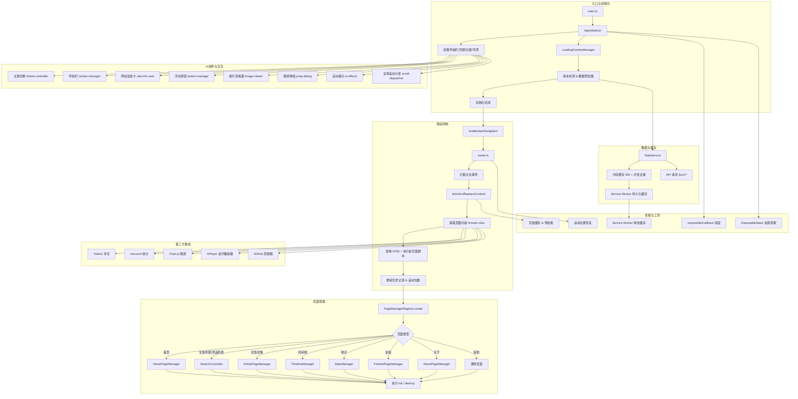

## 1. 概述

我的个人网站。

---

## 2. 技术栈

项目为前后端分离静态站点生成架构。

| 层级 | 技术 | 说明 |
|------|----------|-----------|
| **构建系统** | Python 3.12+ | 运行构建脚本（`run.py`），处理 Markdown 解析、数据聚合、静态资源生成 |
| **Markdown 解析** | `markdown` + `pymdown-extensions` | 支持 Frontmatter、Admonition、任务列表、选项卡、代码高亮、数学公式（KaTeX 前端渲染） |
| **数据序列化** | `PyYAML`、`json` | 解析文章 Frontmatter、作品元数据、友链 JSON |
| **颜色提取** | `requests` + `Pillow` | 为友链头像提取主色调，生成 `friend_colors.json` |
| **CSS 压缩** | Lightning CSS（Vite 8 插件） | 构建时压缩 CSS 并合并 `core.css`，见 `scripts/css-pipeline.mts` |
| **日期处理** | `python-dateutil`、`packaging` | 解析多种日期格式，版本号排序 |
| **前端语言** | TypeScript 7.0.2 | 所有交互逻辑、页面管理器、路由、UI 组件均使用 TypeScript 编写，部分传统模块为 JavaScript |
| **前端构建工具** | Vite 8.3.0 | 编译打包 TypeScript、压缩合并 CSS；dev 时 serve `src/public`，支持 HMR |
| **页面切换** | View Transitions API | 浏览器原生转场（合成器驱动），不支持时降级为直接切换 |
| **响应式** | 移动优先 + 统一断点 | 标准档位 xs/sm(480)/md(640)/lg(768)/xl(1024)/2xl(1280)，规范见 `core/variables.css` 顶部；768 为 JS 与 CSS 的唯一契约点 |
| **路由与 SPA** | 原生 History API + 自定义 Router | 无刷新页面切换，支持 `popstate`、滚动位置恢复、内存页面缓存（LRU 清理）、资源动态加载/卸载 |
| **状态管理** | 单例模式 + 内存缓存 + Service Worker | `DataService` 负责内存缓存与并发去重，持久化缓存由 Service Worker 负责；`storageController` 管理 localStorage 设置、访客记录等 |
| **样式系统** | 原生 CSS + CSS 变量 | 模块化设计：`core/`（变量、布局、基础）、`components/`（导航、评论、页脚等）、`pages/`（各页面独有样式），支持明暗主题自动切换 |
| **图表渲染** | Chart.js 4.4.0 | 统计仪表板动态加载，绘制文章趋势、分类占比、标签排行、代码分布等图表，主题自适应 |
| **评论系统** | Twikoo 2.0.12 | 无后端评论，部署于 Netlify Functions，支持 Markdown、邮件通知 |
| **访问统计** | vercount | 基于 `vercount.one` 服务，统计站点/页面 PV、UV，兼容不蒜子数据属性 |
| **图片查看器** | 自定义 DOM + CSS Transform | 支持缩放（滚轮/双指）、旋转、拖拽、键盘快捷键、全屏、画廊模式，无第三方依赖 |
| **音乐播放器** | APlayer | 悬浮播放器，自动加载网易云歌单，支持歌词显示、音量控制、播放列表 |
| **通用弹窗** | `jump-dialog` + `detail-dialog` | 基于原生 DOM 构建，复用友链卡片样式，支持锚点放大动画、倒计时自动跳转、键盘操作 |
| **Service Worker** | 自定义 `sw.js` | 精细化缓存策略：静态资源（Cache First）、JSON 数据（Stale-While-Revalidate）、HTML 文档（Network First），启用 Navigation Preload |
| **数据格式** | JSON（API 数据）、YAML（文章 Frontmatter） | 所有内容数据（文章、作品、统计、友链、版本日志）均以 JSON 形式提供给前端，构建时生成 |
| **部署** | GitHub Actions + GitHub Pages | 自动化构建部署，详见 `.github/workflows/static.yml`（构建 / 部署拆分为两个作业） |

运行期版本由以下文件统一锁定，本地与 CI 共用同一份来源：

| 文件 | 作用 |
|------|------|
| `.python-version` | Python 版本（`setup-python` 的 `python-version-file`） |
| `.nvmrc` | Node.js 版本（`setup-node` 的 `node-version-file`） |
| `pyproject.toml` | Python 依赖真源：`[project].dependencies` 与 dev 组 |
| `uv.lock` | Python 依赖精确锁文件（版本 / wheel / sha256），CI 用 `uv sync --frozen` 还原 |
| `package.json` / `package-lock.json` | Node 依赖（CI 用 `npm ci` 精确还原） |

---

### 依赖版本详情

#### Python 依赖（`pyproject.toml` + `uv.lock`）

生产依赖：
```
markdown               # 核心 Markdown 解析
pyyaml                 # Frontmatter 解析
requests               # 友链头像下载
pillow                 # 图像主色提取
python-dateutil        # 日期解析
packaging              # 版本号排序
pymdown-extensions     # 扩展 Markdown 语法
```

dev 组（精确锁版本，避免上游发版让 CI 突然变红）：
```
ruff==0.17.4           # lint / format 检查
```

`uv.lock` 由 `uv lock` 生成，记录每个包的版本、wheel URL 与 sha256；CI 用
`uv sync --frozen --all-groups` 严格还原，不再使用 pip / `requirements.txt`。

#### Node.js 依赖（`package.json`）

```json
{
  "devDependencies": {
    "@biomejs/biome": "^2.5.15",
    "lightningcss": "^1.33.0",
    "typescript": "^7.0.2",
    "vite": "^8.3.0"
  }
}
```

---

## 快速开始

```bash
# 1) 安装依赖
uv sync --frozen --all-groups   # Python：按 uv.lock 精确还原（含 dev 组的 ruff）
npm ci                          # Node：按 package-lock.json 精确还原

# 2) 激活虚拟环境；之后 python / ruff 都来自 .venv
source .venv/bin/activate        # Windows: .venv\Scripts\activate

# 3) 开发预览
npm run dev                     # Vite dev server（serve src/public + TS 源码）

# 4) 完整构建（内容 + 前端，唯一发布入口）
npm run build                   # = python run.py + vite build
npm run build -- --clean        # 清空 dist 后全量重建（发布前推荐）
npm run build:content           # 只跑内容侧（HTML / RSS / JSON / 静态资源）
npm run build:frontend          # 只跑前端（TS 打包 + CSS 压缩合并）

# 5) 质量门禁（CI 每次 push / PR 都会跑，本地建议提交前自查）
npm run typecheck               # tsc --noEmit（strict，tsconfig.json）
npm run lint                    # biome（TS/JS 正确性规则）
npm run lint:py                 # uv run ruff（builder/ 与 run.py）
```

四条门禁全部通过才允许部署，另有一组产物冒烟断言（关键文件存在、
robots 有绝对 Sitemap 地址、sitemap 不含 404 页面、index 有 OG/canonical、
favicon 体积上限），见 `.github/workflows/static.yml` 的 `Smoke check dist`。

---

## 3. 目录结构

```txt
Website
├─ .github
│  └─ workflows
│     └─ static.yml
├─ builder
│  ├─ generators
│  │  ├─ aggregated.py
│  │  ├─ base.py
│  │  └─ friend_colors.py
│  ├─ build_context.py
│  ├─ common.py
│  ├─ config.py
│  ├─ engine.py
│  ├─ input_loader.py
│  ├─ static_assets.py
│  └─ __init__.py
├─ dist
├─ node_modules
├─ src
│  ├─ assets
│  │  ├─ source
│  │  │  ├─ 分类一
│  │  │  │  └─ 马生复宋濂书.md
│  │  │  └─ 分类二
│  │  │     └─ 网站的起源.md
│  │  ├─ avatar.webp
│  │  ├─ friends.json
│  │  ├─ friend_colors.json
│  │  ├─ gallery.json              # 图库数据（发布为 /json/gallery.json）
│  │  └─ gallery                   # 图库示例图（换成自己的图片后可删）
│  │     └─ sample-01.webp … sample-08.webp
│  ├─ public                      # 原样发布到 dist 根目录（约定式，加文件即可）
│  │  ├─ .well-known
│  │  │  └─ vercount-verify-pof0sq1cg39g4rpkl66s6rtf.txt
│  │  ├─ js
│  │  │  └─ vendor                # 第三方 min.js（APlayer / vercount / browser.global）
│  │  │     ├─ APlayer.min.js
│  │  │     ├─ browser.global.min.js
│  │  │     └─ vercount.min.js
│  │  ├─ BingSiteAuth.xml
│  │  ├─ favicon.ico
│  │  └─ robots.txt
│  ├─ css
│  │  ├─ components
│  │  │  ├─ comments.css
│  │  │  ├─ footer.css
│  │  │  ├─ github-contrib-graph.css
│  │  │  ├─ image-viewer.css
│  │  │  ├─ loading-overlay.css
│  │  │  ├─ navbar.css
│  │  │  └─ tooltip.css
│  │  ├─ core
│  │  │  ├─ base.css
│  │  │  ├─ components.css
│  │  │  ├─ layout.css
│  │  │  └─ variables.css
│  │  ├─ pages
│  │  │  ├─ 404.css
│  │  │  ├─ about.css
│  │  │  ├─ article.css
│  │  │  ├─ friends.css
│  │  │  ├─ gallery.css
│  │  │  ├─ home.css
│  │  │  ├─ stats.css
│  │  │  └─ timeline.css
│  ├─ js
│  │  ├─ core
│  │  │  ├─ app-initializer.ts
│  │  │  ├─ core.ts
│  │  │  ├─ data-service.ts
│  │  │  ├─ disposable-stack.ts
│  │  │  ├─ modal-base.ts
│  │  │  ├─ page-manager.ts
│  │  │  ├─ page-runtime.ts
│  │  │  ├─ scroll-dispatcher.ts
│  │  │  ├─ theme-controller.ts
│  │  │  └─ twikoo-manager.ts
│  │  ├─ data
│  │  │  ├─ settings.ts
│  │  │  ├─ site-state.ts
│  │  │  └─ sw.js
│  │  ├─ entry
│  │  │  └─ main.ts
│  │  ├─ pages
│  │  │  ├─ about.ts
│  │  │  ├─ article.ts
│  │  │  ├─ friends-manager.ts
│  │  │  ├─ gallery.ts             # 图库独立入口（不加载 main.js）
│  │  │  ├─ home-manager.ts
│  │  │  ├─ search-render.ts
│  │  │  ├─ stats-manager.ts
│  │  │  ├─ timeline.ts
│  │  │  └─ stats
│  │  │     ├─ chart-registry.ts
│  │  │     └─ charts.ts
│  │  ├─ router
│  │  │  └─ router.ts
│  │  ├─ standalone
│  │  │  └─ 404.ts
│  │  ├─ ui
│  │  │  ├─ button-manager.ts
│  │  │  ├─ detail-dialog.ts
│  │  │  ├─ image-manager.ts
│  │  │  ├─ image-viewer.ts
│  │  │  ├─ jump-dialog.ts
│  │  │  ├─ list-events.ts
│  │  │  ├─ loading-overlay-manager.ts
│  │  │  ├─ navbar-manager.ts
│  │  │  ├─ site-info-card.ts
│  │  │  ├─ site-ambient-text.ts
│  │  │  ├─ theme.ts
│  │  │  ├─ tooltip.ts
│  │  │  └─ ui-effects.ts
│  │  └─ vendor
│  │     └─ global-music-player.ts   # TS 源文件，由 Vite 编译
│  ├─ templates
│  │  ├─ 404.html
│  │  ├─ about.html
│  │  ├─ contact.html
│  │  ├─ footer.html
│  │  ├─ gallery.html
│  │  ├─ index.html
│  │  ├─ stats.html
│  │  └─ timeline.html
│  └─ works                        # 作品（Git 子模块）
│     ├─ 作品一                    # 纯外链作品：只保留元数据
│     │  └─ metadata.json
│     └─ 作品二                    # 站内作品：页面 + 约定命名的资源
│        ├─ index.html
│        ├─ work-style.css
│        ├─ work-js.js
│        ├─ data.json              # 可选
│        └─ metadata.json
├─ .gitignore
├─ .gitmodules
├─ .nvmrc
├─ .python-version
├─ CHANGELOG.md
├─ CNAME
├─ LICENSE
├─ package-lock.json
├─ package.json
├─ pyproject.toml
├─ README.md
├─ run.py
├─ uv.lock                       # Python 依赖精确锁文件
├─ scripts
│  ├─ build.mjs                  # 统一构建编排（内容 + 前端）
│  └─ css-pipeline.mts           # CSS 压缩合并 Vite 插件
└─ vite.config.mts
```

---

## 4. 构建系统详解

将源码（Markdown、元数据、前端资源）转换为可部署的静态网站。整个系统由 Python 编写，模块化设计，支持增量构建、并行执行和扩展。

### 4.1 核心组件

| 组件 | 文件 | 职责 |
|------|------|------|
| **数据模型** | `build_context.py` | 定义 `Article`、`Work`、`Friend`、`BuildContext` 等数据结构，作为构建上下文在各模块间传递。 |
| **公共工具** | `common.py` | 提供日志、JSON 读写、哈希计算、日期格式化、路径处理等通用函数。 |
| **输入加载器** | `input_loader.py` | 扫描 `src/assets/source/` 下的 Markdown 文件、`src/works/` 下的作品元数据、`src/assets/friends.json` 友链以及根目录的 `CHANGELOG.md` 更新日志，解析后填充 `BuildContext`。 |
| **构建配置** | `config.py` | 定义 `BuildConfig`（force / clean / offline / strict / parallel / max_workers / dry_run / ci），一次构建的所有开关集中在此，经 `BuildContext.options` 下发给各生成器。 |
| **构建引擎** | `engine.py` | 管理所有生成器（`OutputGenerator`），协调执行顺序，支持串行/并行运行，并依据 `.build_state.json` 进行增量判断；返回 `BuildReport` 汇总耗时与结果。 |
| **生成器基类** | `generators/base.py` | 定义生成器抽象接口，包含 `name`、`inputs`、`outputs`、`generate()` 等方法，以及输入哈希计算和状态更新逻辑。 |
| **静态资源同步** | `static_assets.py` | 声明式管理所有“非构建资源”（`AssetRule`）：统一负责 `src/public/`、`src/assets/`、`src/works/`、模板页与友链 JSON 的发布，并基于内容哈希做增量复制。 |
| **聚合生成器** | `generators/aggregated.py` | 核心生成器，负责生成绝大部分输出：统计 JSON、RSS、站点地图、文章/作品/友链列表页、无 JS 回退页、复制静态资源（素材、模板页、vendor 库）等。 |
| **友链颜色生成器** | `generators/friend_colors.py` | 独立生成器，通过下载友链头像并提取主色调，生成 `friend_colors.json` 用于前端卡片背景色。 |
| **入口脚本** | `run.py` | 命令行入口，解析参数，注册生成器，启动构建引擎。 |

### 4.2 构建流程

1. **装配配置**：`run.py` 依据命令行 + 环境变量构造 `BuildConfig`，必要时清理 `dist/`（`--clean`）。
2. **加载输入**：`InputLoader` 读取所有源文件，生成 `BuildContext` 对象（`ctx.options` 携带本次构建配置）。
3. **生成器注册**：在 `run.py` 中注册 `FriendColorsGenerator` 和 `AggregatedGenerator`。
4. **增量判断**：引擎检查每个生成器的输出文件是否都存在，并比对输入数据的哈希值（以及静态资源哈希），若未变化则跳过。
5. **执行生成**：按依赖分层，层内并行调用各生成器的 `generate()` 方法，将结果写入 `dist/` 目录。
6. **更新状态**：成功生成后，将当前输入哈希（及 `AggregatedGenerator` 的静态资源哈希）与时间戳写入 `.build_state.json`，供下次增量判断使用。

### 4.3 增量构建机制

- **状态文件**：`.build_state.json` 存储每个生成器上次运行的“输入哈希”和“静态资源哈希”，并带 `_version` 字段；格式或哈希算法升级时旧状态自动失效，退化为一次全量构建。
- **输入哈希**：由生成器声明的依赖（如 `articles`、`works`）的序列化内容计算而得，任一源文件改动都会导致哈希变化。
- **静态资源哈希**：`AggregatedGenerator` 用 `static_assets.static_sources_hash()` 监控所有"原样复制"的源（覆盖 `src/public/`、`src/assets/`、`src/works/`、模板页与友链 JSON），由规则自动派生，新增规则无需同步维护清单；该哈希通过重写 `build_state_entry()` 写入。前端源文件（`src/js/`、`src/css/`）不在此列——它们由 Vite 独立构建，改动不该触发内容侧重新生成 HTML / RSS。
- **哈希算法**：统一使用 BLAKE2b(128bit)。相比 MD5 更快，且在启用 FIPS 的运行环境中不会报错。
- **产物一致性**：所有由构建系统写出的文本/JSON 统一使用 LF 换行，避免 Windows 本地构建与 CI（Linux）产物出现换行差异。
- **强制重建**：通过 `--force` 参数可忽略所有增量判断，强制全量构建；`--force-colors` 可单独强制更新友链颜色。

### 4.4 生成器详解

#### AggregatedGenerator（聚合生成器）

这是最主要的生成器，其 `generate()` 方法依次执行以下任务：

- **统计生成**：统计文章数、总字数、标签/分类频次、作者数、更新天数等，写入 `dist/json/statistics.json`。
- **RSS 生成**：从文章和作品中提取条目，按时间排序生成 `dist/rss.xml`。
- **站点地图**：生成 `dist/sitemap.xml`，包含所有文章及固定页面。
- **文章列表页**：渲染 `dist/articles/index.html`，包含标签筛选、搜索框、排序功能，数据通过 `window.__STATIC_ARTICLES_DATA` 注入。
- **作品列表页**：渲染 `dist/works/index.html`，类似文章列表，数据通过 `window.__STATIC_WORKS_DATA` 注入。
- **友链页面**：渲染 `dist/friends/index.html`，包含友链卡片（带主题色）和申请要求说明。
- **无 JS 回退页**：生成 `dist/nojs.html`，提供完全静态的内容列表，方便搜索引擎或禁用 JavaScript 的用户访问。
- **子目录页面**：将 `src/templates/` 下的 `about.html`、`timeline.html`、`stats.html`、`contact.html` 复制到对应的 `dist/about/`、`dist/timeline/` 等目录。
- **前端构建**：由 `scripts/build.mjs` 统一编排——先 `python run.py` 生成内容侧产物，再 `vite build` 编译 TypeScript；任一步失败即中止。Python 不再嵌套调用 npm，两侧各自只写自己负责的目录。
- **CSS 压缩**：由 Vite 插件 `scripts/css-pipeline.mts` 用 Lightning CSS 压缩 `src/css/` 并输出 `dist/css/`，同时按层叠顺序合并出 `dist/css/core.css`。
- **静态资源同步**：调用 `static_assets.sync_static_assets()`，一次同步所有非构建资源，见下节。
- **代码分析**：生成 `dist/json/code_analysis.json`，记录 `dist/` 目录下各文件类型的数量、大小和行数统计，便于监控构建产物规模。

#### FriendColorsGenerator（友链颜色生成器）

- **功能**：为每个友链的头像图片提取主色调，生成 `src/assets/friend_colors.json`（映射：网站链接 → [R, G, B]）。
- **缓存**：头像图片会被缓存到临时目录，避免重复下载。
- **依赖**：需 `requests` 和 `Pillow` 库，若未安装则生成器跳过（但构建不会失败，只会使用默认灰色）。
- **增量**：默认只处理新增或缺失颜色的友链，使用 `--force-colors` 可强制刷新所有；已删除的友链颜色会被自动清理。
- **并发与容错**：头像下载使用带重试的连接池 + 线程池并发（默认 8 并发，`FRIEND_COLOR_WORKERS` 可调），结果缓存到 `FRIEND_AVATAR_CACHE_DIR`（默认系统临时目录，仅供本地重新抓色时复用；CI 离线不抓头像）；单个站点失败时**保留已有颜色**，只有从未取到颜色的友链才会落到默认灰色，不会因网络抖动让已缓存的颜色来回变化。`--offline` / `SKIP_NETWORK=1` 可完全跳过网络请求。
- **持久化缓存**：`src/assets/friend_colors.json` 随仓库提交，本地与 GitHub Actions 共用同一份历史颜色，只为新增友链发起请求；该文件缺失时日志会明确告警（CI 中另有校验步骤直接失败，避免静默退化为全量抓取）。

#### 静态资源规则（`builder/static_assets.py`）

所有“非构建资源”（原样复制的文件）都在 `STATIC_ASSET_RULES` 中声明，构建流程里不再散落 `shutil.copy` / `copytree` 调用：

| 源 | 目标 | 说明 |
|------|------|------|
| `src/public/**` | `dist/**` | 站点根文件：`favicon.ico`、`robots.txt`、`BingSiteAuth.xml`、`.well-known/` 验证文件，以及 `js/vendor/*.min.js`。**新增文件放进该目录即可发布，无需改代码**；文本产物支持 `{{SITE_URL}}` 占位符 |
| `CHANGELOG.md` | `dist/CHANGELOG.md` | 网站更新日志（Keep a Changelog 格式），原样发布到站点根 |
| `src/assets/**` | `dist/assets/**` | 全局素材（头像、图片、数据 JSON），排除 `source/`（Markdown 源） |
| `src/works/**` | `dist/works/**` | 作品子页面资源，排除 `metadata.json`（仅构建期使用） |
| `src/assets/*.json` | `dist/json/*.json` | 友链数据与主题色，直接作为 `/json` 接口发布 |
| `src/templates/*.html` | `dist/` 或 `dist/<子目录>/index.html` | 首页 / 404 / 页脚片段，以及 `PAGE_TEMPLATES` 定义的子目录页 |

规则语义：

- `source` 为**目录**：递归复制，按 `include` / `exclude` 过滤并保持相对结构；
- `source` 为 **glob**（如 `src/assets/*.json`）：复制所有匹配文件，保持相对“通配根”的结构；
- `source` 为**单文件**：复制到 `destination`，可顺便重命名（如 `about.html` → `about/index.html`）。

同步行为：

- **增量**：目标与源一致（size + mtime 相同，或内容哈希相同）即跳过写入，避免无意义写盘与 mtime 抖动；复制用 `copy2` 保留 mtime，跨平台表现一致；
- **并行**：文件复制走线程池（`MAX_SYNC_WORKERS`，可用 `cfg.parallel=False` 关闭）；
- **安全**：默认排除 `.git` / `.github` / `__pycache__` / `.DS_Store` 等元数据（不影响需要发布的 `.well-known/`）；标记 `required=True` 的源缺失会记为错误，并在严格模式（CI 默认）下中止构建；
- **增量联动**：`static_sources_hash()` 由规则自动派生并计入静态资源哈希，新增规则无需再维护一份哈希清单。

扩展方式：新增一类资源只需追加一条 `AssetRule`，生成器代码保持不变。

### 4.5 命令行用法

> 下面的 `python run.py ...` 假定已按快速开始执行 `source .venv/bin/activate`。
> 不想激活环境时，给命令加 `uv run` 前缀即可（如 `uv run python run.py --clean`），
> `uv run` 会把 `.venv/bin` 加进 PATH；CI 正是用 `uv run --no-sync npm run build`。

```bash
# 完整构建（内容 + 前端，唯一发布入口）
npm run build

# 发布前干净全量构建（--clean 透传给内容侧，先清空 dist 再完整重建）
npm run build -- --clean

# 只跑内容侧（增量，最快；写 Markdown / 调 API 时用）
python run.py

# 全量构建（忽略增量状态）
python run.py --force

# 仅强制更新友链颜色（其他生成器仍按增量判断）
python run.py --force-colors

# 只运行指定生成器（如只生成友链颜色）
python run.py --targets friend_colors

# 离线构建：跳过所有网络请求（友链头像等）
python run.py --offline

# CI 模式：纯文本日志 + 严格模式（等价于 CI=true python run.py）
python run.py --ci

# 宽容模式：生成出错时仍继续构建（默认失败即中止）
python run.py --no-strict

# 禁用并行执行 / 调整并行线程数（默认自动：CI=4，本地取 CPU 数量且 ≤8）
python run.py --no-parallel
python run.py --workers 6

# 预览执行计划而不真正生成
python run.py --dry-run

# 列出可用生成器
python run.py --list
```

### 4.5.1 环境变量

| 变量 | 作用 |
|------|------|
| `CI` / `GITHUB_ACTIONS` | 自动开启 CI 模式（纯文本日志、严格模式） |
| `NO_COLOR` / `FORCE_COLOR` | 手工控制日志着色 |
| `LOG_LEVEL` | 日志级别（默认 `INFO`，排错可设 `DEBUG`） |
| `BUILD_WORKERS` | 默认并行线程数 |
| `FRIEND_COLOR_WORKERS` | 友链头像并发数 |
| `FRIEND_AVATAR_CACHE_DIR` | 头像字节缓存目录（默认系统临时目录；仅本地重新抓色时复用，CI 离线不抓头像） |
| `SKIP_NETWORK` | 等价于 `--offline`；CI 设为 `true`，内容侧完全不联网 |

### 4.6 依赖与环境

- **版本来源**：Python 版本取自 `.python-version`，Node.js 版本取自 `.nvmrc`，CI 与本地共用，避免“我这儿能跑”。
- **Python 依赖**：真源在 `pyproject.toml`，精确版本由 `uv.lock` 锁定；主要包括 `markdown`、`pyyaml`、`requests`、`pillow`、`python-dateutil`、`packaging`、`pymdown-extensions`，dev 组另有固定版本的 `ruff`。
- **Node.js 依赖**：用于前端 TypeScript 编译，见 `package.json`，使用 Vite 作为构建工具。
- **代码规范**：`pyproject.toml` 提供项目元数据与 ruff / black 配置；`biome.json` 管 TS/JS 与 `scripts/`。
- **安装命令**（`uv sync` 会创建 `.venv`；CI 用 `--frozen` 严格按锁文件还原）：

```bash
uv sync --frozen --all-groups
npm ci
```

### 4.7 扩展新生成器

若需增加自定义输出（如生成 JSON 摘要、额外页面），可继承 `OutputGenerator` 基类并实现抽象方法，然后在 `run.py` 中注册。例如：

```python
from builder.generators.base import OutputGenerator
from builder.build_context import BuildContext

class MyGenerator(OutputGenerator):
    name = "mygen"
    inputs = {"articles"}
    outputs = [Path("dist/my.json")]

    def generate(self, context: BuildContext, force: bool) -> bool:
        # 使用 context.articles 生成 my.json
        return True
```

注册：

```python
engine.register(MyGenerator())
```

---

## 5. 前端架构

前端采用 **单页应用 (SPA)** 模式，基于原生 TypeScript 构建，无第三方框架依赖。核心设计遵循 **模块化**、**可维护性** 和 **性能优先** 原则，通过自定义路由、页面管理器、数据服务层和 UI 组件库，实现流畅的页面切换、高效的数据缓存和丰富的交互体验。

---

### 5.1 整体架构图



---

### 5.2 模块划分与职责

| 模块路径 | 职责 |
|---------|------|
| **`/js/entry/main.ts`** | 应用入口，启动 `AppInitializer`，暴露全局 API（如 `fetchAndReplaceContent`） |
| **`/js/core/app-initializer.ts`** | 启动编排器，按阶段执行：基础设施、页面骨架、空闲任务、收尾与展示 |
| **`/js/router/router.ts`** | 核心路由引擎：拦截同源链接，基于 `History API` 实现无刷新导航，支持 `popstate`、锚点跳转、滚动位置管理、内存页面缓存（LRU 清理）和资源动态加载/卸载。页面管理器通过 `PageManagerRegistry` 注册。 |
| **`/js/core/page-manager.ts`** | 页面管理器基类，定义 `init` / `destroy` 契约，内部基于 `DisposableStack` 统一管理资源 |
| **`/js/core/disposable-stack.ts`** | 资源清理栈：集中管理定时器、事件监听、Observer、AbortController 等 |
| **`/js/core/modal-base.ts`** | 通用模态框基础设施：遮罩、容器、生命周期、关闭逻辑 |
| **`/js/core/scroll-dispatcher.ts`** | 全局滚动事件分发器：单监听 + rAF 节流，多订阅者共享 |
| **`/js/core/theme-controller.ts`** | 主题控制器：单一数据源，统一 `auto/light/dark` 模式、系统偏好、存储与事件分发 |
| **`/js/pages/`** | 各页面管理器实现：<br> • `home-manager.ts` – 首页统计、标签云、名言轮播、实时时钟<br> • `search-render.ts` – 文章/作品列表的搜索、筛选、排序、分批渲染<br> • `article.ts` – 文章详情：TOC 高亮、阅读进度、代码复制、图片懒加载、数学公式渲染、移动端侧边栏<br> • `timeline.ts` – 时间线聚合（文章、作品、版本日志），支持年份/类型/搜索过滤<br> • `stats-manager.ts` – 统计仪表板，动态加载 Chart.js 绘制图表<br> • `friends-manager.ts` – 友链卡片随机排序、复制 JSON、跳转弹窗绑定<br> • `about.ts` – 关于页面：年龄升级系统、翻转卡片、GitHub 贡献图 |
| **`/js/pages/stats/`** | 统计图表定义：<br> • `chart-registry.ts` – 图表注册表与上下文类型<br> • `charts.ts` – 8 张图表的具体渲染逻辑，通过 `registerChart` 自注册 |
| **`/js/core/data-service.ts`** | 数据服务单例：统一管理 API 请求，内存缓存（60 秒 TTL）+ 并发请求去重，持久化缓存由 Service Worker 负责，支持强制刷新与预热 |
| **`/js/data/`** | 数据辅助模块：<br> • `searchWorker.ts` – 历史/预留 Web Worker 模块，当前 `SearchController` 未接入<br> • `settings.ts` – 用户设置管理（外链拦截、主题、字体、滚动揭示、天空时间、天气、云速）<br> • `site-state.ts` – 统计记录同步、Service Worker 注册、页脚信息填充 |
| **`/js/ui/`** | UI 组件集合：<br> • `theme.ts` – 仅绑定导航栏主题开关，状态由 `theme-controller` 管理<br> • `navbar-manager.ts` – 导航栏 DOM 生成、移动端适配、标题替换模式<br> • `site-info-card.ts` – 网站信息卡：方形圆角头像（`/assets/avatar.webp`）、「此刻」文案、运行时长、文章/作品数、建站日期与出口链接<br> • `site-ambient-text.ts` – 「此刻」文案生成器：把地理 / 天气 / 农历 / 月相 / 季节揉成一段可读的话（变体按「日期+小时」确定性挑选，同一小时稳定；拿不到天气时退成只说时令）<br> • `button-manager.ts` – 返回顶部、目录（移动端）、设置按钮<br><br> • `image-manager.ts` – 全局图片懒加载与点击查看器绑定<br> • `image-viewer.ts` – 图片查看器（DOM + CSS Transform，缩放、旋转、拖拽、键盘控制）<br> • `jump-dialog.ts` – 通用跳转确认弹窗，支持锚点放大动画<br> • `detail-dialog.ts` – 通用详情弹窗（作品信息、设置面板）<br> • `list-events.ts` – 列表项点击处理（作品弹窗、文章导航）<br> • `loading-overlay-manager.ts` – 加载遮罩层，展示版本更新日志<br> • `sky-backdrop.ts` – 渐变天空背景：按时间插值天色、简笔云朵与星空随滚动视差、临近地面淡出；远景山脉分三层，各自独立定位与视差（远山更高更慢，近丘更低更快），山体为不透明实心层<br> • `ground.ts` – 全局地面（地平线）：分隔页面上与页面下，首页可在地面上放快捷导航<br> • `tooltip.ts` – 全局工具提示<br> • `ui-effects.ts` – 滚动揭示（IntersectionObserver）、外链拦截管理、UI 特效编排 |
| **`/js/core/core.ts`** | 核心工具库：配置常量、存储控制器（含 LZ 压缩兼容）、空闲调度、导航事件总线、通用工具函数、性能监控器 |
| **`/js/core/weather-service.ts`** | 真实天气查询（UAPI）：30 分钟缓存、并发去重、失败降级为晴天；按天气图标码映射背景天气，覆盖晴/多云/阴/雨/雪/雨夹雪/雷暴/雾/霾/沙尘/大风 |
| **`/js/core/lunar-service.ts`** | 农历查询（UAPI）：当天缓存（跨日失效）、并发去重、失败降级为无农历；由农历日推算月相供背景月亮与卡片文案使用 |
| **`/js/core/page-runtime.ts`** | 页面运行时：站点年龄更新、页脚更新时间 |
| **`src/js/vendor/`** | `global-music-player.ts` – 动态加载 APlayer、创建悬浮播放器的 TS 源文件（由 Vite 编译） |
| **`src/public/js/vendor/`** | 原样发布的第三方库：`APlayer.min.js`（音乐播放器核心）、`vercount.min.js`（访问统计）、`browser.global.min.js`（GitHub 贡献图组件）。经 Python 静态资源规则复制到 `dist/js/vendor/`，dev 时由 Vite `publicDir` 直接 serve |
| **`/js/pages/404.ts`** | 404 页面独立逻辑，包含智能路径分析和自定义错误消息 |

---

### 5.3 核心流程

#### 5.3.1 应用启动流程

1. **入口**：`main.ts` 监听 `DOMContentLoaded`，调用 `AppInitializer.start()`。
2. **编排器阶段**：
   - **阶段 1：基础设施**
     - 添加预连接、预加载标签。
     - 初始化滚动揭示。
     - 同步主题（`themeController.init()`）。
     - 空闲时初始化渐变天空背景（`sky-backdrop`）。
   - **阶段 2：页面骨架**
     - 等待加载导航栏。
     - 异步加载页脚。
     - 渲染个人卡片。
     - 启动站点年龄更新器。
     - 初始化浮动按钮。
   - **阶段 3：空闲任务**
     - 启用无刷新导航与列表点击。
     - 初始化当前页面特性（`initPageFeatures`）。
     - 初始化 UI 特效、预热 DataService、图片懒加载、全局图片查看器、页脚统计。
     - 加载音乐播放器。
   - **阶段 4：收尾**
     - 注册 `popstate`。
     - 显示加载覆盖层（`LoadingOverlayManager`）。
     - 播放导航栏入场动画。
     - 标记 `data-loaded`。
     - 注册 Service Worker（生产环境；开发环境注销）。

#### 5.3.2 路由与页面切换

- 用户点击同源链接 → `router.ts` 拦截（`enableAjaxNavigation`）。
- 调用 `fetchAndReplaceContent(url)`：
  1. 检查内存页面缓存，若命中且未过期则直接使用。
  2. 否则发起 `fetch` 请求。
  3. 解析 HTML，提取 `#router-view` 内容、样式表、脚本。
  4. 执行 DOM 替换（带淡入淡出动画）。
  5. 卸载旧页面的资源（样式/脚本）。
  6. 加载新页面的资源，并通过 `PageManagerRegistry` 初始化对应 `PageManager`。
  7. 恢复滚动位置（从 `history.state` 或锚点）。
  8. 触发 `ajax:navigation` 事件，供其他模块监听。

#### 5.3.3 数据流

- 所有 API 请求通过 `DataService` 单例发出。
- 策略：
  1. **内存缓存**：TTL 60 秒。
  2. **并发去重**：同一请求多个调用共享同一个 Promise。
  3. **持久化缓存**：由 Service Worker 负责（`/json/` 数据采用 Stale-While-Revalidate）。
  4. **强制刷新**：通过 `cache: 'reload'` 通知 SW 绕过缓存。
  5. **网络失败降级**：返回过期内存缓存。
- 页面管理器在 `init` 中调用 `DataService` 获取数据，并渲染 UI。

#### 5.3.4 搜索与筛选（文章/作品列表）

- 使用 `SearchController`（位于 `search-render.ts`）管理列表页。
- 核心逻辑在当前主线程执行，使用 `debounce` 与 `requestAnimationFrame` 分批渲染（每批 20 项），避免一次性插入大量 DOM。
- 支持标签筛选、关键词搜索（标题/标签/日期）、多种排序（更新时间、字数、发布日期）。
- URL 参数与搜索状态双向同步（`pushState` 更新）。
- `searchWorker.ts` 为历史/预留模块，当前未接入。

#### 5.3.5 页面管理器生命周期

- 每个页面管理器实现 `init` 和 `destroy` 方法。
- 推荐继承 `PageBase`，在 `mount()` 中注册资源到 `this.stack`，在 `unmount()` 中做额外收尾。
- `init`：绑定事件、加载数据、渲染 DOM、初始化第三方组件（如 Twikoo）。
- `destroy`：清理事件监听、定时器、观察者，重置 DOM（防止内存泄漏）。
- 路由切换时自动调用旧页面的 `destroy` 和新页面的 `init`。

---

### 5.4 性能优化策略

| 优化点 | 实现方式 |
|-------|---------|
| **懒加载** | 图片懒加载（`IntersectionObserver`）、组件异步加载（动态 `import()`） |
| **缓存** | 内存缓存（60s TTL）+ Service Worker 离线缓存（`stale-while-revalidate`） |
| **并发控制** | `DataService` 去重，避免重复请求；`requestIdleCallback` 调度非关键任务 |
| **渲染优化** | 列表分批次渲染、使用 `DocumentFragment`、减少回流 |
| **代码分割** | Vite 构建，按入口分割（`main`、`404`、`settings` 等） |
| **资源预加载** | 预连接第三方域、预加载首屏图片、`<link rel="preload">` |
| **滚动性能** | `ScrollDispatcher` 单监听 + rAF 节流，`passive` 监听器，`will-change` 提示 |
| **动画性能** | 使用 CSS `transform`/`opacity` 触发 GPU 加速，避免 JS 动画阻塞主线程 |
| **资源清理** | `DisposableStack` 集中管理事件、定时器、Observer、AbortController |

---

### 5.5 技术选型说明

| 技术 | 用途 | 理由 |
|------|------|------|
| **TypeScript** | 前端语言 | 提供类型安全、更好的 IDE 支持和代码可维护性 |
| **Vite** | 构建工具 | 极速冷启动、按需编译、原生 ESM，适合现代浏览器 |
| **原生 History API** | 路由 | 轻量、无依赖，与 SPA 无缝集成 |
| **内存缓存 + Service Worker** | 数据缓存 | 内存缓存降低请求频率，SW 提供离线与持久化缓存 |
| **IntersectionObserver** | 懒加载、滚动揭示 | 高性能，减少滚动事件监听 |
| **ScrollDispatcher** | 滚动事件分发 | 单监听 + rAF 节流，多订阅者共享 |
| **DisposableStack** | 资源清理 | 集中释放事件、定时器、Observer，避免内存泄漏 |
| **Chart.js** | 统计图表 | 轻量、易用、主题自适应 |
| **Twikoo** | 评论系统 | 无后端、部署简单，支持 Markdown |
| **vercount** | 访问统计 | 轻量、隐私友好 |
| **APlayer** | 音乐播放器 | 支持歌单、歌词显示，界面美观 |

---

### 5.6 扩展指南

#### 添加新页面

1. 在 `src/templates/` 创建 HTML 模板（含 `#router-view` 等占位）。
2. 在 `builder/static_assets.py` 的 `PAGE_TEMPLATES` 中注册（模板名 → 子目录），构建时自动复制到 `dist/<子目录>/index.html`。
3. 在 `src/js/pages/` 下创建对应的 `XxxManager.ts`，推荐继承 `PageBase`，实现 `mount()` / `unmount()`。
4. 在 `src/js/router/router.ts` 的 `registerDefaultPages()` 中使用 `PageManagerRegistry.register(pattern, factory)` 注册页面管理器。
5. 在导航栏（`navbar-manager.ts` 的 `NAV_LINKS`）添加链接项。
6. 重新运行构建。

#### 自定义 UI 组件

- 新建文件于 `src/js/ui/`，导出核心函数。
- 遵循“事件绑定与销毁”模式，确保在页面切换时能清理资源。
- 若需全局弹窗，可使用 `detail-dialog.ts` 或 `jump-dialog.ts` 作为基础。
- 若需管理复杂资源，使用 `DisposableStack`。

#### 修改主题或样式

- CSS 变量定义在 `src/css/core/variables.css`。
- 主题状态由 `src/js/core/theme-controller.ts` 统一管理。
- 导航栏开关绑定在 `src/js/ui/theme.ts`。
- 图表颜色随主题变化：`stats-manager.ts` 使用 `themeController.onChange` 监听并重建图表。

---

## 6. 关键数据流

### 6.1 文章发布流程

```txt
1. 作者在 src/assets/source/分类/ 下新建 .md 文件（含 frontmatter）
2. 运行 uv run npm run build（内容侧 + 前端；或激活 .venv 后直接 npm run build）
3. input_loader 解析 MD，生成 HTML 到 dist/articles/
4. 更新 dist/json/articles.json
5. aggregated 生成统计、RSS、站点地图
6. 前端构建：Vite 编译 TS、Lightning CSS 压缩合并 CSS
7. 部署 dist/ 到服务器
```

### 6.2 前端页面加载流程（以文章详情为例）

```txt
1. 用户点击文章链接（或直接输入 URL）
2. router 拦截，fetch 获取 /articles/xxx.html
3. 提取 #router-view 内容，替换
4. 初始化 ArticlePageManager
5. ArticlePageManager：
   - 初始化现有 TOC 结构与链接点击
   - 初始化阅读进度条
   - 启用图片懒加载（IntersectionObserver）
   - 初始化代码块复制
   - 初始化移动端侧边栏
   - 保存/恢复滚动位置
   - 初始化 Twikoo 评论（动态加载库）
   - 启动数学公式渲染（KaTeX）
   - 更新 vercount 统计
   - 监听主题变化刷新阅读进度
6. 记录滚动位置到 sessionStorage（返回时恢复）
```

### 6.3 搜索与筛选流程（文章/作品列表）

```txt
1. 页面加载时，DataManager 从缓存或网络获取数据。
2. SearchController 从 URL 解析查询参数（q, field, tags, sort）。
3. 在主线程过滤、排序数据。
4. UIRenderer 生成 HTML，使用 requestAnimationFrame 分批插入列表容器（每批 20 项）。
5. 滚动揭示效果重新触发（ScrollReveal）。
6. 用户修改搜索/标签/排序时，更新 URL 并重复上述过程。
```

---

## 7. 数据格式规范

### 7.1 文章 Frontmatter（YAML）

```yaml
---
title: 文章标题
date: 2026-05-24
description: 简介
author: 高新炀
tag: [随笔, 生活]
category: 随笔   # 可选，默认使用所在子目录名
last_updated: 2026-06-01   # 可选，缺省时按内容哈希自动维护
cover: /assets/cover.webp  # 可选，文章列表项的封面/背景图
---
```

- `date` 支持 `YYYY-MM-DD` 或 `YYYY年MM月DD日`。
- `tag` 可为数组或逗号分隔字符串。
- `cover` 可选，填写图片 URL 或站内路径（如 `/assets/xxx.webp`）；未填写时不显示背景图。
- 包含 `隐藏` 标签的文章将不出现在列表/RSS/统计中，但仍生成 HTML 到 `.hidden/`。
- 文章列表项按「作者 · 字数 · 阅读时长 · 发布于 xx · 更新于 xx」一行展示；
  缺失的日期会被整体省略，不会显示占位文案。

### 7.2 作品元数据（`works/作品名/metadata.json`）

```json
{
  "title": "作品标题",
  "date": "2026-01-01",
  "description": "描述",
  "author": "高新炀",
  "tag": ["工具", "游戏"],
  "link": "https://example.com",   // 可留空，默认指向 /works/作品名/
  "cover": "/assets/work.webp",    // 可选，作品卡片的封面/背景图
  "archived": false                // 可选，true 时卡片右上角标记“已归档 · 不再维护”
}
```

- `cover` 与 `archived` 均为可选字段，缺省分别等价于「无封面」与「未归档」。
- `archived` 支持 `true` / `"true"` / `1` / `"yes"` 等写法。

**作品目录约定**（站内作品，即未填写外链 `link` 的目录）：

| 文件 | 作用 |
|------|------|
| `index.html` | 作品页面入口，发布为 `/works/<作品名>/` |
| `work-style.css` | 样式，统一命名，页面用 `/works/<作品名>/work-style.css` 引用 |
| `work-js.js` | 脚本，统一命名，页面用 `/works/<作品名>/work-js.js` 引用 |
| `data.json` | 可选，作品自带数据 |
| `metadata.json` | 构建期元数据，不会被复制到 `dist/` |

约定要点：样式与脚本一律外链，不在 `index.html` 内联 `<style>` / `<script>`；站内资源统一使用以 `/works/<作品名>/` 开头的绝对路径；文件统一 UTF-8 编码。

### 7.3 友链（`dist/json/friends.json`）

```json
[
  {
    "name": "站点名称",
    "link": "https://example.com",
    "desc": "描述",
    "avatar": "https://example.com/avatar.png"
  }
]
```

### 7.4 统计 JSON（`statistics.json`）字段

| 字段 | 说明 |
|------|------|
| `version` | 版本号（来自更新日志最新版本 ID） |
| `last_updated` | 最新更新日期 |
| `total_articles` | 文章总数 |
| `total_word_count` | 总字数 |
| `total_works` | 作品总数 |
| `article_tags` | `[{name, count}, ...]` 按次数降序 |
| `article_categories` | 同 `article_tags` |
| `work_tags` | 同 `article_tags` |
| `total_update_days` | 有更新的日期天数 |

### 7.5 网站更新日志（根目录 `CHANGELOG.md`）

更新日志位于仓库根目录 `CHANGELOG.md`，格式遵循 [Keep a Changelog 1.1.0](https://keepachangelog.com/zh-CN/1.1.0/)：

- **版本标题**：`## [8.45.6] - 2026-09-27`；被回滚的版本追加 `[YANKED]` 标记；只有日期、没有版本号的标题（`## 2025-12-06`）属于旧日志，构建时标记 `is_old`。
- **变动类型小节**：`### 新增` / `### 变更` / `### 弃用` / `### 移除` / `### 修复` / `### 安全`（也允许自定义小节，如 `### 已知问题`），小节名会原样成为条目的 `type`。
- **变更条目**：0 缩进的 `- 描述`，其后以空白缩进的行为该条目的续行；条目之间的空行不影响归属。
- **`## [Unreleased]`**：收集尚未发布的改动，构建时整体忽略，发版时再把内容移动到新的版本块。

构建期由 `input_loader.parse_changelog()` 解析成 `dist/json/version.json`（索引）与 `dist/json/version/version-N.json`（正文分片），条目随小节分组后进入时间线与加载覆盖层，类型徽标按 `type` 着色。

### 7.6 图库（`src/assets/gallery.json`）

图库页 `/gallery/` 的数据源。`src/assets/*.json` 会由 `static_assets.py` 同时发布到
`/assets/gallery.json` 与 `/json/gallery.json`，页面 fetch 的是后者（与其它 `/json/*.json`
接口保持一致）。

```json
{
  "updated": "2026-11-08",
  "items": [
    {
      "id": "sample-01",
      "url": "/assets/gallery/sample-01.webp",
      "title": "晨雾里的第一束光",
      "description": "把清晨的薄雾与暖色一起收进画面。",
      "date": "2026-11-08",
      "width": 800,
      "height": 600,
      "tags": ["风景", "晨光"]
    }
  ]
}
```

| 字段 | 必填 | 说明 |
|------|------|------|
| `url` | 是 | 图片地址，站内绝对路径或完整 URL 均可；为空的条目会被跳过 |
| `title` | 否 | 标题，缺失时显示「未命名」；同时作为 `` 的 `alt` |
| `description` | 否 | 简介，hover 浮层里最多显示两行 |
| `date` | 否 | 日期，`YYYY-MM-DD` 会渲染成 `YYYY.MM.DD` 并写进 `<time datetime>` |
| `width` / `height` | 否（强烈建议填） | 图片原始像素尺寸。**填了就能在图片加载前算准卡片高度**，零额外请求、零布局跳动；不填则脚本会探测图片真实比例（4 秒超时后回退 1:1） |
| `tags` | 否 | 标签数组，浮层里最多显示前 3 个 |
| `id` | 否 | 写进卡片的 `data-id`，方便自定义样式或脚本定位 |

顶层 `items` 必须是数组；`updated` 只是给人看的备注，页面不消费。仓库里附带的 8 条
`示例 · …` 与 `src/assets/gallery/sample-*.webp` 只是演示用，替换成自己的图片后删掉即可。

页面行为与可调项见 8.1 的「独立页面」。

---

## 8. 开发与扩展指南

### 8.1 添加新页面

1. 在 `src/templates/` 下创建新的 HTML 模板，包含 `#navbar-placeholder`、`#site-info-card-container`、`#footer-placeholder`、`#router-view` 等占位。
2. 在 `builder/static_assets.py` 的 `PAGE_TEMPLATES` 字典中添加映射（模板名 → 子目录），构建时自动复制到 `dist/<子目录>/index.html`。
3. 若页面需要动态初始化，在 `src/js/pages/` 下创建对应的页面管理器，推荐继承 `PageBase`。
4. 在 `src/js/router/router.ts` 的 `registerDefaultPages()` 中使用 `PageManagerRegistry.register(pattern, factory)` 注册该页面管理器。
5. 在导航栏（`navbar-manager.ts` 的 `NAV_LINKS`）中添加链接项。
6. 重新运行构建。

#### 独立页面（不走 SPA / 不挂导航与页脚）

图库页 `/gallery/` 是个例外，适合"先做出来、暂不接入站点导航"的场景：

- `src/templates/gallery.html` 只引 `/css/core.css` 与 `/css/pages/gallery.css`，
  **不加载 `/js/entry/main.js`**，因此不会出现导航栏、页脚、侧边栏、音乐播放器、
  加载遮罩，也不会被 SPA 路由接管；也不含 `#navbar-placeholder` 等占位节点。
- 在 `builder/static_assets.py` 的 `PAGE_TEMPLATES` 加一条映射即可输出
  `dist/gallery/index.html`；数据放 `src/assets/gallery.json`（格式见 7.6）。
- 页面脚本是**独立 Vite 入口**：`vite.config.mts` 的 `rollupOptions.input` 里
  声明了 `js/pages/gallery`，产物为 `/js/pages/gallery.js`。不 import 任何站点模块，
  所以打包体积与主包完全隔离，主题只通过读同一个 `localStorage` 键跟随。
- 瀑布流用「最高图优先投进最矮列」（LPT）分配：卡片高度 = 列宽 ÷ 宽高比，
  再把较矮列的卡片等比放大一点（上限 1.22 倍，`object-fit: cover` 只轻微裁切）
  来补齐列底，避免底部出现大片空白。列数随容器宽度分 2/3/4/5/6 档，
  且不超过 `ceil(图片数 / 2)`；列数不变时只更新高度、不重排 DOM。
  图片用 `aspect-ratio` 提前占位，`loading="lazy"`，加载失败会显示占位文案。
  因为是按高度而非按 JSON 顺序分配，**跨列的先后不保证与数据顺序一致**（列内仍按
  JSON 顺序），这是换取列底齐平的取舍；不需要轻微拉伸时可把脚本里的
  `MAX_STRETCH` 设为 `1`。
- 可调的 CSS 变量在 `src/css/pages/gallery.css` 顶部：`--gallery-gap`（卡片间距，
  设 `0px` 可无缝拼接）、`--gallery-gutter`（容器左右留白，默认 `0px` 即真·全屏）、
  `--gallery-radius`（默认站点小圆角）、`--gallery-overlay`（信息浮层底色）。
- hover / 键盘 focus 时浮出标题、简介、日期与标签；触屏（无 hover）时信息常显，
  但只留标题 + 日期（收起简介与标签），避免常显的信息条盖住大半张图片。
- 目前**没有**加入 `NAV_LINKS`、`footer.html` 与 sitemap 的硬编码页面列表，
  只能直接访问 `/gallery/`；将来要接入时按上面 1–6 步补即可。

### 8.2 自定义生成器

若需扩展构建输出（如生成 JSON 摘要、额外页面等），可继承 `OutputGenerator`：

```python
from builder.generators.base import OutputGenerator
from builder.build_context import BuildContext

class MyGenerator(OutputGenerator):
    name = "mygen"
    inputs = {"articles", "works"}   # 依赖的上下文属性
    outputs = [Path("dist/myfile.json")]

    def generate(self, context: BuildContext, force: bool) -> bool:
        # 使用 context.articles, context.works 等生成
        return True
```

然后在 `run.py` 中注册：

```python
engine.register(MyGenerator())
```

### 8.3 修改前端构建（Vite）

- 入口文件：`src/js/entry/main.ts`。
- Vite 配置：`vite.config.mts` 将 `src/js` 映射为 `/js`，构建输出到 `dist/`，路径基于配置文件自身位置解析，不依赖当前工作目录。
- `build.emptyOutDir` 必须为 `false`：dist 由 Python 构建系统与 Vite 共同写入，清空会删除其他生成器已写入的 HTML / JSON / RSS；需要干净构建请用 `npm run build -- --clean`。
- `build.copyPublicDir` 必须为 `false`：`src/public` 由 Python 的 `static_assets.py` 同步（要渲染 `robots.txt` 里的 `{{SITE_URL}}`），Vite 若也复制一份原样文件会覆盖渲染结果。`publicDir` 本身仍设为 `src/public`，供 dev server serve。
- CSS 由 `scripts/css-pipeline.mts` 插件处理（Lightning CSS 压缩 + `core.css` 合并），产物路径与 HTML 中的 `<link>` 保持一致。
- 生产构建统一由 `npm run build` 触发，`scripts/build.mjs` 依次调用 `python run.py` 与 `vite build`；Python 不再嵌套调用 npm。`npm run build -- --clean` / `-- --offline` 等参数会透传给内容侧。
- `scripts/` 下的构建脚本也纳入 Biome 检查（`npm run lint`），与 `src/js` 共用同一套格式 / 正确性规则。

### 8.4 调试技巧

- **构建日志**：`builder/common.py` 提供 `log_info/warning/error`，彩色输出。
- **前端调试**：Chrome DevTools。
- **数据缓存**：`DataService` 使用内存缓存（60s），持久化数据在 Service Worker 的 Cache Storage 中；`localStorage` 主要保存设置、访客记录等。
- **性能分析**：`core/core.ts` 中的 `PerformanceMonitor` 自动记录关键操作耗时，超过 100ms 会输出警告。
- **Service Worker**：可在 Chrome Application 面板中手动注销或更新。
- **主题调试**：使用 `themeController.getMode()` / `getTheme()` 查看当前状态。

---

## 9. 部署说明

### 9.1 自动化部署（GitHub Actions）

`.github/workflows/static.yml` 在 `push` 到 `main` 或手动触发时运行，拆分为两个作业：

| 作业 | 职责 |
|------|------|
| `build` | 检出（含子模块）→ `uv sync --frozen` / `npm ci` → 三项质量门禁 → 校验友链主题色缓存覆盖 → 离线 `npm run build` → 产物冒烟检查 → 上传 `dist` 为 Pages artifact（PR 跳过上传） |
| `deploy` | `actions/deploy-pages` 发布 artifact 到 GitHub Pages 环境（PR 跳过） |

要点：

- **uv + 锁文件**：Python 依赖由 `uv sync --frozen --all-groups` 按 `uv.lock` 精确还原，`astral-sh/setup-uv` 的 `enable-cache` 负责缓存；`ruff` 版本锁在 dev 组，不再每次拉最新版。Node 依赖仍由 `setup-node` 的 npm 缓存 + `npm ci` 还原。
- **CI 完全离线**：`src/assets/friend_colors.json` 随代码提交，本地跑一次 `npm run build` 就会把新增友链的颜色写进 json；CI 构建前逐条校验缓存覆盖全部友链，缺一条就快速失败并提示本地补跑，随后以 `SKIP_NETWORK=true` 运行，既不抓头像也不访问任何外部站点。因此部署不再受友链站点可用性影响，也不会静默写入兜底灰；原先的头像字节 `actions/cache` 步骤已移除。
- **不使用 `--force`**：CI 每次都是全新检出，不存在 `.build_state.json`，本来就等价于全量构建；`--force` 只会额外触发全部友链头像重抓，拖慢构建并增加网络失败概率。
- **PR 只验证**：`Upload artifact` 与 `deploy` 作业都加了 `if: github.event_name != 'pull_request'`，PR 不再白白打包上传产物。
- **隐藏文件**：`upload-pages-artifact` 从 v4 起默认排除点文件，站点有 `.well-known/` 验证文件，因此上传时显式开了 `include-hidden-files: true`，冒烟检查也加了一条 `.well-known` 非空断言。
- **严格模式**：GitHub Actions 自动注入 `CI=true`，`scripts/build.mjs` 据此给内容侧追加 `--ci`；任一步失败即让工作流失败，避免部署半成品。
- **Actions 版本**（2026-11 逐个核实后一次性升级）：`checkout@v7`、`setup-python@v6`、`setup-node@v6`、`setup-uv@v7`、`upload-pages-artifact@v5`、`configure-pages@v6`、`deploy-pages@v5`。`checkout@v7` 的行为变更只影响 `pull_request_target` / `workflow_run`，本工作流的普通 `pull_request` 不受影响。
- 版本统一由 `.python-version` / `.nvmrc` 提供；构建作业设有 `timeout-minutes`，异常任务不会长期占用 runner。

### 9.2 手动构建

```bash
uv sync --frozen --all-groups
npm ci
source .venv/bin/activate
npm run build -- --clean     # 干净全量构建：清空 dist + 内容侧 + 前端
```

构建产物位于 `dist/` 目录，可直接上传到任意静态托管平台（GitHub Pages、Netlify、Vercel 等）。

注意事项：

1. 确保 `CNAME` 文件内容为自定义域名（如需）。
2. 若使用 Twikoo，需部署云函数并更新各页面中的 `envId`。
3. 发布前建议使用 `--clean`，避免 dist 中残留的旧文件被一并部署。

---

## 10. 许可证

- **代码**：MIT License
- **文章内容**：CC BY-NC-ND 4.0（除特别声明外）

---

*本文档持续更新，以项目最新代码为准。*  
*维护者：高新炀*  
*最后更新：2026-10-04*